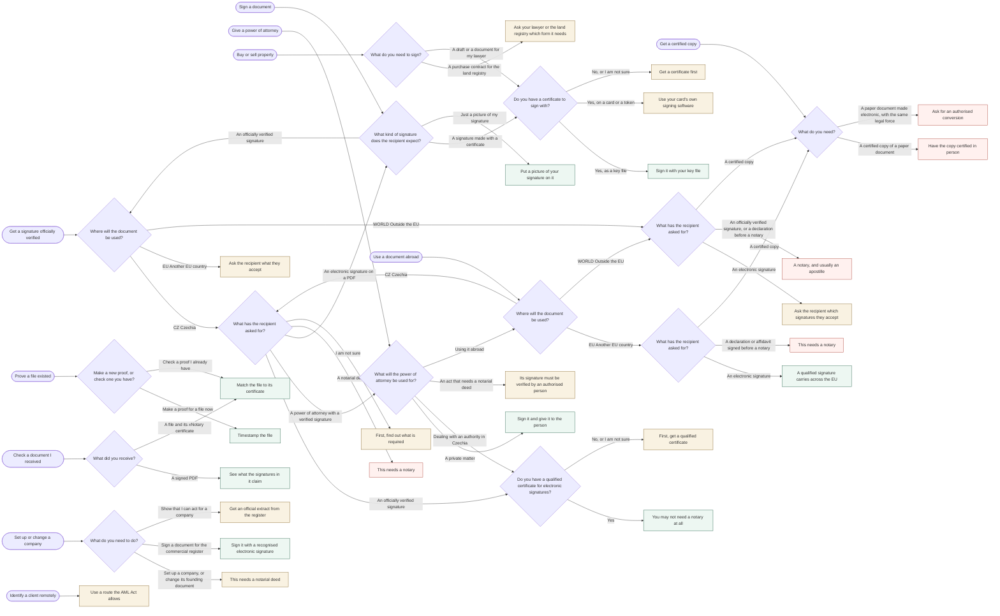

# Situations map

<!-- Generated from app/src/site/situations.ts by `npm run situations:map`. Do not edit: CI fails when this is stale. -->

Every journey on `/situations/`, the questions it asks and the outcomes they lead to, with each
outcome's traffic light, sources and the day they were read. It is for the team and for legal
review, not for visitors, and it replaces hand-drawn decision trees: it cannot drift from what the
site says, because it is made from the same data. The Czech is in `situations.cs.ts`;
`npm run i18n:review` lays it beside the English.

## The graph

## Get a signature officially verified (`#official`)

Somebody asked for a certified or officially verified signature.

### ❓ `official-where` — Where will the document be used?

The rules of the country it goes to apply — not the rules where you are now.

- **CZ** Czechia → `official-ask`
- **EU** Another EU country → `official-eu`
- **WORLD** Outside the EU → `abroad-ask-world`

### ❓ `official-ask` — What has the recipient asked for?

A signed PDF, an officially verified signature and a notarial deed are three different things. If you are not sure, choose the last answer.

- An officially verified signature — *Required by a law — in Czech, úředně ověřený podpis.* → `official-cert`
- A power of attorney with a verified signature → `poa-what`
- An electronic signature on a PDF — *A signed document, with no official certification.* → `sign-kind`
- A notarial deed — *A document a notary has to draw up.* → `official-deed`
- I am not sure → `official-unsure`

### ❓ `official-cert` — Do you have a qualified certificate for electronic signatures?

A qualified trust service provider issues one after checking who you are. A certificate from an employer or an internal system does not count.

- Yes — *As a key file (.p12, .pfx), or on a card or token.* → `official-cz`
- No, or I am not sure → `official-nocert`

### 🟢 online `official-cz` — You may not need a notary at all

Where a law requires an officially verified signature, Czech law accepts a recognised electronic signature instead — if the authority can confirm through the population register that the qualified certificate is yours (§ 6(2) of Act 12/2020 Coll.).

**Why this route:** The document goes to Czechia, a law asks for an officially verified signature, and you have a qualified certificate: that is when § 6(2) of Act 12/2020 Coll. lets a recognised electronic signature stand in for it.

1. Check the exception first. The route does not apply to a power of attorney for an act that needs a public deed, such as a notarial deed (§ 6(3)), and another law may require a particular form.
2. Register your qualified certificate in the population register through Portál občana (Profile → Certificates). Only its public part goes in, never the key. Some certificates carry identification data that makes this unnecessary: your provider can say.
3. Sign the document with that certificate: with a key file in Sign a PDF here, or with a card or token in its own software. In Czech law, an advanced signature based on a qualified certificate is a recognised electronic signature.
4. Send it the way the authority asks: through a data box, its electronic filing office, or by e-mail with a recognised electronic signature. The authority checks against the register that the certificate is yours; this site does not, and cannot.
5. If the office has not handled this before, point them to the DIA guidance listed under Sources, and ask them to check the signature in their own system.

Tools: Sign a PDF (`/xsignature/#/document`)

Sources, checked 2026-10-28:
- [DIA: replacing an officially verified signature (§ 6(2), Act 12/2020 Coll.)](https://www.dia.gov.cz/cs/legislativa/eidas-sluzby-vytvarejici-duveru-a-elektronicka-identifikace/informace-pro-uzivatele/pravo-na-nahrazeni-uredne-overeneho-podpisu-dle-ss-6-odst-2-zakona-c-12-2020-sb)
- [Act 12/2020 Coll., § 6](https://www.zakonyprolidi.cz/cs/2020-12)
- [Portál veřejné správy: registering a qualified certificate in the population register](https://portal.gov.cz/rozcestniky/zapis-kvalifikovaneho-certifikatu-do-registru-obyvatel-RZC-113)
- [Act 297/2016 Coll., § 6 — the recognised electronic signature](https://www.zakonyprolidi.cz/cs/2016-297)

### 🟡 with help `official-nocert` — First, get a qualified certificate

It is the one step the online route cannot skip, and a qualified trust service provider does it, not this site.

**Why this route:** The online route rests on a qualified certificate tied to you, and you do not have one yet.

1. Choose a provider listed for Czechia on the EU trust list.
2. It checks who you are — at a branch, or online with some providers — and issues the certificate as a key file or on a card.
3. Then follow the route: register the certificate in Portál občana, sign with it, and send the document as the authority asks.

Sources, checked 2026-10-28:
- [EU trust list: qualified trust service providers](https://eidas.ec.europa.eu/efda/trust-services/browse/eidas/tls)
- [DIA: replacing an officially verified signature (§ 6(2), Act 12/2020 Coll.)](https://www.dia.gov.cz/cs/legislativa/eidas-sluzby-vytvarejici-duveru-a-elektronicka-identifikace/informace-pro-uzivatele/pravo-na-nahrazeni-uredne-overeneho-podpisu-dle-ss-6-odst-2-zakona-c-12-2020-sb)

Examples (not endorsements):
- [PostSignum (Česká pošta)](https://www.postsignum.cz/kvalifikovane_certifikaty.html) — qtsp, checked 2026-11-11: Qualified certificates for electronic signatures. The first one is issued at a post office with Czech POINT services, or by a mobile registration authority; a renewal can be requested online.
- [I.CA (První certifikační autorita)](https://www.ica.cz/zaciname) — qtsp, checked 2026-11-11: Qualified certificates for electronic signatures. Individuals can apply online, with identity checked through the ZealiD app, or at a registration authority. Remote signing, where the provider keeps the key, is a separate service from the certificate.

### 🔴 in person `official-deed` — This needs a notary

A notarial deed is drawn up by a notary. No signature tool, here or anywhere else, makes one.

**Why this route:** A notarial deed is an act of the notary, not a kind of signature.

1. Ask the recipient which country the deed must come from.
2. Ask a notary there whether you can take part by video. In Czechia the Notarial Code allows it with an electronic identity at the high level (§ 64a), where the notary offers it.

Sources, checked 2026-10-28:
- [Notarial Code, Act 358/1992 Coll., §§ 64a and 74a](https://www.zakonyprolidi.cz/cs/1992-358)

### 🟡 with help `official-unsure` — First, find out what is required

Signing a PDF, having a signature officially verified and having a deed drawn up are different procedures. Doing the wrong one costs more than asking.

**Why this route:** The route depends on what the recipient asked for, and that is not known yet.

1. Ask the recipient: do you accept an electronic signature, or do you need an officially verified signature or a notarial deed?
2. If an officially verified signature: ask which law requires it. The online route applies only where a law does.
3. Come back with the answer and start again.

### 🟡 with help `official-eu` — Ask the recipient what they accept

Each country decides how a signature is officially verified. A qualified electronic signature has the effect of a handwritten one across the EU, but it is not an officially verified signature by itself, anywhere.

**Why this route:** The document goes to another EU country, and only that country's rules decide how a signature is officially verified there.

1. Ask whether they accept a qualified electronic signature, or their own country’s electronic substitute for a verified one.
2. If not: a notary, at home or in their country. Some act remotely, by video.
3. A signature made here from a key file is advanced, not qualified: check that the recipient accepts that level.

Sources, checked 2026-10-28:
- [eIDAS Regulation (EU) 910/2014, art. 25](https://eur-lex.europa.eu/legal-content/EN/TXT/?uri=CELEX:02014R0910-20240520)

## Sign a document (`#sign`)

With your certificate, or with a picture of your signature.

### ❓ `sign-kind` — What kind of signature does the recipient expect?

A picture of a signature and a signature made with a certificate look alike on the page. They are not the same thing.

- A signature made with a certificate — *A digital signature: it shows who holds the key, and that the file has not changed since.* → `sign-setup`
- Just a picture of my signature — *Where a visible mark is enough: forms, letters.* → `sign-picture`
- An officially verified signature — *Certified or legalised.* → `official-where`

### ❓ `sign-setup` — Do you have a certificate to sign with?

A certificate authority issues it after checking who you are. It is what ties a signature to you.

- Yes, as a key file — *A .p12, .pfx or .pem file, and its password.* → `sign-keyfile`
- Yes, on a card or a token — *A smart card, a USB token, or an identity card with a chip.* → `sign-card`
- No, or I am not sure → `sign-nocert`

### 🟢 online `sign-keyfile` — Sign it with your key file

Sign a PDF places your signature on the page and signs the file with your certificate, in this browser.

**Why this route:** The recipient expects a signature made with a certificate, and your key is in a file this browser can read.

1. The key file is read on your device and never sent.
2. A signature made from a key file is an advanced signature, never a qualified one: a file can be copied. Check that the recipient accepts that level.

Tools: Sign a PDF (`/xsignature/#/document`)

### 🟡 with help `sign-card` — Use your card's own signing software

A key on a card or a token cannot be reached from a web page, so this site cannot sign with it. That the key never leaves certified hardware is what makes such a signature qualified.

**Why this route:** Your key is on a card or a token, which a web page cannot reach.

1. Sign with the software that came with your card, or that your certificate authority provides.
2. You can then check what the signed file claims here.

Tools: Check a signed file (`/xsignature/#/check`)

### 🟡 with help `sign-nocert` — Get a certificate first

A certificate authority issues one after checking who you are — some online, some in person.

**Why this route:** A signature made with a certificate needs a certificate, and you do not have one yet.

1. Ask the recipient which level of signature they accept.
2. For a qualified certificate, choose a provider on the trust list of the framework the recipient works under — in the EU, a qualified trust service provider.
3. Come back and sign with the key file it gives you, or with its own software if the key stays on a card.

Sources, checked 2026-10-28:
- [EU trust list: qualified trust service providers](https://eidas.ec.europa.eu/efda/trust-services/browse/eidas/tls)

Examples (not endorsements):
- [PostSignum (Česká pošta)](https://www.postsignum.cz/kvalifikovane_certifikaty.html) — qtsp, checked 2026-11-11: Qualified certificates for electronic signatures. The first one is issued at a post office with Czech POINT services, or by a mobile registration authority; a renewal can be requested online.
- [I.CA (První certifikační autorita)](https://www.ica.cz/zaciname) — qtsp, checked 2026-11-11: Qualified certificates for electronic signatures. Individuals can apply online, with identity checked through the ZealiD app, or at a registration authority. Remote signing, where the provider keeps the key, is a separate service from the certificate.
- [Bank iD](https://bankid.cz/lide/podepisujte/) — identity, checked 2026-11-11: Signs with your Czech bank login. Its signature is advanced (zaručený), not qualified: by its own terms, for private matters, while a document for an authority needs a recognised electronic signature.

### 🟢 online `sign-picture` — Put a picture of your signature on it

Make the picture once, then place it on the PDF.

**Why this route:** The recipient expects only a visible mark, not a signature that shows who signed.

1. A picture proves nothing about who put it there: anyone with the image can do the same.

Tools: Make a signature image (`/xsignature/#/signature`), Place it on a PDF (`/xsignature/#/document`)

## Give a power of attorney (`#poa`)

Let someone act for you — privately, before an authority or at a notary.

### ❓ `poa-what` — What will the power of attorney be used for?

The form it needs depends on what the other person will do with it.

- A private matter — *Collecting a parcel, dealing with a landlord or a company.* → `poa-private`
- Dealing with an authority in Czechia — *When the authority asks for an officially verified signature.* → `official-cert`
- An act that needs a notarial deed — *Founding a company, some property and family matters.* → `poa-deed`
- Using it abroad → `abroad-where`

### 🟢 online `poa-private` — Sign it and give it to the person

A power of attorney for a private matter needs no particular form, unless the other side asks for one.

**Why this route:** A power of attorney for a private matter has no required form.

1. Write who may act, for what, and until when.
2. Sign it — with a certificate for stronger evidence of who signed, or by hand.
3. Ask whoever will rely on it whether they want the signature officially verified.

Tools: Sign a PDF (`/xsignature/#/document`)

### 🟡 with help `poa-deed` — Its signature must be verified by an authorised person

For an act that needs a public deed, the power of attorney needs an officially verified signature, and the electronic substitute in § 6(2) of Act 12/2020 Coll. does not apply to it (§ 6(3)).

**Why this route:** § 6(3) of Act 12/2020 Coll. excludes exactly this power of attorney from the electronic route.

1. Have the signature verified in person, at a notary or a Czech POINT office.
2. Or ask the notary whether they can verify an electronic signature remotely (§ 74a of the Notarial Code), or whether you can take part in the notarial act by video yourself instead of giving a power of attorney (§ 64a).
3. Agree the route with the notary first: not every notary offers the remote options.

Sources, checked 2026-10-28:
- [Act 12/2020 Coll., § 6](https://www.zakonyprolidi.cz/cs/2020-12)
- [Civil Code, Act 89/2012 Coll., § 441(2)](https://www.zakonyprolidi.cz/cs/2012-89)
- [Notarial Code, Act 358/1992 Coll., §§ 64a and 74a](https://www.zakonyprolidi.cz/cs/1992-358)

## Prove a file existed (`#proof`)

A record of this exact file at this time, without sending it anywhere.

### ❓ `proof-kind` — Make a new proof, or check one you have? *(chooses a tool; the "I want to…" box may answer it)*

No certificate is needed for either.

- Make a proof for a file now — *Later, show that this exact version existed by then.* → `proof-make`
- Check a proof I already have — *Match the original file to its certificate.* → `proof-check`

### 🟢 online `proof-make` — Timestamp the file

Only a fingerprint of the file leaves your device. Keep the file and its certificate together.

**Why this route:** You want evidence of when a file existed, which needs no certificate and nobody else.

1. A timestamp shows the file existed by that time. It says nothing about who wrote it, or whether it is true.

Tools: Prove a file existed (`/xnotary/#/notarize`)

### 🟢 online `proof-check` — Match the file to its certificate

You need the original file, unchanged, and the certificate made for it.

**Why this route:** You have a file and the certificate made for it, so the question is whether they match.

1. A match shows the file existed by the time the certificate states. It does not show who wrote it.

Tools: Verify an xNotary proof (`/xnotary/#/verify`)

## Check a document I received (`#check`)

What a signed PDF claims, or whether a file matches its proof.

### ❓ `check-kind` — What did you receive? *(chooses a tool; the "I want to…" box may answer it)*

Two different checks, for two different things.

- A signed PDF — *See who it says signed it, and whether it changed since.* → `check-pdf`
- A file and its xNotary certificate — *Match the file to the proof.* → `proof-check`

### 🟢 online `check-pdf` — See what the signatures in it claim

Check a signed file reads each signature, and whether the file has changed since it was signed.

**Why this route:** You received a signed PDF, so the first question is what its signatures claim.

1. Whether the signer's certificate deserves trust is for your PDF reader to say, against the trust list of the framework it was issued under.

Tools: Check a signed file (`/xsignature/#/check`)

## Get a certified copy (`#copy`)

A copy an authority accepts as matching the original.

### ❓ `copy-what` — What do you need?

A scan, a fingerprint or a timestamp is not a certified copy: it shows when a file existed, not that it matches a paper original.

- A certified copy of a paper document — *In Czech, vidimace.* → `copy-paper`
- A paper document made electronic, with the same legal force — *Or the reverse. In Czech, autorizovaná konverze.* → `copy-convert`

### 🔴 in person `copy-paper` — Have the copy certified in person

An authorised office compares the copy with the original and certifies that they match.

**Why this route:** A certified copy compares paper with paper, which only an authorised office can do.

1. Take the original to a Czech POINT office (many post offices and municipal offices) or to a notary.
2. If you only need to show that a file existed at a given time, a timestamp does that online — but it is not a certified copy.

Tools: Prove a file existed instead (`/xnotary/#/notarize`)

Sources, checked 2026-10-28:
- [Act 21/2006 Coll., on certifying copies and signatures](https://www.zakonyprolidi.cz/cs/2006-21)

### 🔴 in person `copy-convert` — Ask for an authorised conversion

Authorised conversion turns a paper document into an electronic one, or the reverse, with the same legal force as the original.

**Why this route:** Only authorised conversion gives the new form the legal force of the original.

1. A Czech POINT office, a notary or another authorised office does it. Bring the original.

Sources, checked 2026-10-28:
- [Act 300/2008 Coll., authorised conversion](https://www.zakonyprolidi.cz/cs/2008-300)

## Set up or change a company (`#company`)

Founding documents, and papers for the commercial register.

### ❓ `company-what` — What do you need to do?

Some company documents need a notary; others need only a verified signature.

- Set up a company, or change its founding document — *For example a limited company (s.r.o.).* → `company-deed`
- Sign a document for the commercial register — *For example an owner's consent to a registered office.* → `company-filing`
- Show that I can act for a company — *An official extract from the commercial register.* → `company-authority`

### 🟡 with help `company-deed` — This needs a notarial deed

Founding a limited company and changing its founding document are done before a notary, as a notarial deed.

**Why this route:** By law, a limited company is founded by a notarial deed.

1. Ask a notary whether you can take part by video with an electronic identity (§ 64a of the Notarial Code). Not every notary offers it.
2. The notary usually files the change with the commercial register directly.

Sources, checked 2026-10-28:
- [Notarial Code, Act 358/1992 Coll., §§ 64a and 74a](https://www.zakonyprolidi.cz/cs/1992-358)

### 🟢 online `company-filing` — Sign it with a recognised electronic signature

Where the register requires an officially verified signature on such a document, the Czech online route applies: a recognised electronic signature on a qualified certificate that can be tied to you through the population register (§ 6(2) of Act 12/2020 Coll.).

**Why this route:** The register asks for an officially verified signature, and in Czechia § 6(2) of Act 12/2020 Coll. lets a recognised electronic signature replace it.

1. Check the exception first. The route does not apply to a power of attorney for an act that needs a public deed, such as a notarial deed (§ 6(3)), and another law may require a particular form.
2. Register your qualified certificate in the population register through Portál občana (Profile → Certificates). Only its public part goes in, never the key. Some certificates carry identification data that makes this unnecessary: your provider can say.
3. Sign the document with that certificate: with a key file in Sign a PDF here, or with a card or token in its own software. In Czech law, an advanced signature based on a qualified certificate is a recognised electronic signature.
4. Send it the way the authority asks: through a data box, its electronic filing office, or by e-mail with a recognised electronic signature. The authority checks against the register that the certificate is yours; this site does not, and cannot.
5. If the office has not handled this before, point them to the DIA guidance listed under Sources, and ask them to check the signature in their own system.

Tools: Sign a PDF (`/xsignature/#/document`)

Sources, checked 2026-10-28:
- [DIA: replacing an officially verified signature (§ 6(2), Act 12/2020 Coll.)](https://www.dia.gov.cz/cs/legislativa/eidas-sluzby-vytvarejici-duveru-a-elektronicka-identifikace/informace-pro-uzivatele/pravo-na-nahrazeni-uredne-overeneho-podpisu-dle-ss-6-odst-2-zakona-c-12-2020-sb)
- [Act 12/2020 Coll., § 6](https://www.zakonyprolidi.cz/cs/2020-12)
- [Portál veřejné správy: registering a qualified certificate in the population register](https://portal.gov.cz/rozcestniky/zapis-kvalifikovaneho-certifikatu-do-registru-obyvatel-RZC-113)
- [Act 297/2016 Coll., § 6 — the recognised electronic signature](https://www.zakonyprolidi.cz/cs/2016-297)

### 🟡 with help `company-authority` — Get an official extract from the register

Who may act for a company is in the commercial register, and the register issues the proof. A printout from its public website is for information only: it is not an official extract.

**Why this route:** Only the register can show who may act for a company, so the proof must come from it.

1. In Czechia: a verified extract from a Czech POINT office, or an officially verified electronic copy from the register (§§ 3 and 5 of Act 304/2013 Coll.).
2. In Slovakia: request the electronic extract through the e-service on slovensko.sk. The registry court issues it free of charge, sealed with a qualified electronic seal, as an .asice file.
3. Before you send an electronic extract on, check its seal in Check a signed file, and send the file exactly as you received it: the seal is what makes it official.

Tools: Check a signed file (`/xsignature/#/check`)

Sources, checked 2026-11-11:
- [Act 304/2013 Coll., on public registers, §§ 3 and 5](https://www.zakonyprolidi.cz/cs/2013-304)
- [Ministry of Justice of the Slovak Republic: a legally usable extract from the commercial register](https://www.justice.gov.sk/faq/ako-mozem-ziskat-pravne-pouzitelny-vypis-z-obchodneho-registra/)

## Buy or sell property (`#property`)

A contract for the land registry, or papers for your lawyer.

### ❓ `property-what` — What do you need to sign?

A contract the land registry will act on, and a document for your lawyer, have different requirements.

- A purchase contract for the land registry → `property-contract`
- A draft or a document for my lawyer → `sign-setup`

### 🟡 with help `property-contract` — Ask your lawyer or the land registry which form it needs

The land registry has its own rules for how a contract is signed, on paper or electronically, and every party has to meet them.

**Why this route:** The land registry sets its own form for a contract it acts on.

1. Ask which signatures it accepts from each party, and whether the contract needs a qualified electronic timestamp.
2. A timestamp from this site is anchored in Bitcoin: it is evidence of when a file existed, not a qualified timestamp.

## Use a document abroad (`#abroad`)

A signature, a declaration or a copy for another country.

### ❓ `abroad-where` — Where will the document be used?

The rules of the country it goes to apply.

- **EU** Another EU country → `abroad-ask-eu`
- **WORLD** Outside the EU → `abroad-ask-world`
- **CZ** Czechia → `official-ask`

### ❓ `abroad-ask-eu` — What has the recipient asked for?

If you are not sure, ask them before you sign anything.

- An electronic signature → `abroad-esig-eu`
- A declaration or affidavit signed before a notary → `abroad-sworn-eu`
- A certified copy → `copy-what`

### 🟢 online `abroad-esig-eu` — A qualified signature carries across the EU

In the EU, a qualified electronic signature has the effect of a handwritten one, and one made in one member state is recognised in all of them.

**Why this route:** Within the EU, a qualified electronic signature made in one member state is recognised in all of them.

1. A signature made here from a key file is advanced, not qualified. Check that the recipient accepts that, or sign with a qualified signature from your provider.
2. Ask whether they also need the signature verified by an authority: a qualified signature is not that.

Tools: Sign a PDF (`/xsignature/#/document`)

Sources, checked 2026-10-28:
- [eIDAS Regulation (EU) 910/2014, art. 25](https://eur-lex.europa.eu/legal-content/EN/TXT/?uri=CELEX:02014R0910-20240520)

### 🔴 in person `abroad-sworn-eu` — This needs a notary

A declaration "before a notary" means a notary sees you sign and certifies it. No signature tool does that.

**Why this route:** Signing before a notary needs the notary to witness it, which no tool can do.

1. A notary in Czechia certifies your signature on the declaration, also on an English-language form.
2. Ask the recipient whether they also need a translation, or an apostille on the notary’s certification.

Sources, checked 2026-10-28:
- [Notarial Code, Act 358/1992 Coll., §§ 64a and 74a](https://www.zakonyprolidi.cz/cs/1992-358)

### ❓ `abroad-ask-world` — What has the recipient asked for?

If you are not sure, ask them before you sign anything.

- An electronic signature → `abroad-esig-world`
- An officially verified signature, or a declaration before a notary — *Including an affidavit.* → `abroad-sworn-world`
- A certified copy → `copy-what`

### 🟡 with help `abroad-esig-world` — Ask the recipient which signatures they accept

Outside the EU, nothing obliges a recipient to accept an electronic signature made under EU rules.

**Why this route:** Outside the EU, the recipient's own rules decide which electronic signatures count.

1. Ask which kind of electronic signature, and which format, they accept.
2. If they accept a signature made with a certificate, sign the PDF and send it as they ask.

Tools: Sign a PDF (`/xsignature/#/document`)

### 🔴 in person `abroad-sworn-world` — A notary, and usually an apostille

A notary certifies your signature. Outside the EU, the recipient’s country usually also wants an apostille on that certification — or, where it is not party to the Hague Convention, a consular legalisation.

**Why this route:** Outside the EU, a notary's certification usually needs an apostille before another country relies on it.

1. Have the signature certified by a notary.
2. Ask the recipient whether they need an apostille, a consular legalisation or a translation, and check the country on the Convention list.

Sources, checked 2026-10-28:
- [Hague Apostille Convention: member countries](https://www.hcch.net/en/instruments/conventions/status-table/?cid=41)
- [Notarial Code, Act 358/1992 Coll., §§ 64a and 74a](https://www.zakonyprolidi.cz/cs/1992-358)

## Identify a client remotely (`#kyc`)

For firms the anti-money-laundering rules oblige to know their client.

### 🟡 with help `kyc-remote` — Use a route the AML Act allows

A firm the AML Act obliges — an estate agent, a leasing company, a lender — must identify a client before doing business. The first identification is in person, unless the Act allows a remote route. This site does not identify anyone.

**Why this route:** The AML Act decides how a client may be identified, and remotely only on its terms.

1. Remotely, the Act accepts an electronic identity at the high level, including a bank identity under the conditions the Act sets (§ 8a).
2. In lower-risk cases it allows a few other remote methods, such as identification data signed with a qualified electronic signature (§ 11).
3. Or a notary or a Czech POINT office identifies the client for you (§ 10).
4. Which route fits depends on the client, the product and the risk: your AML policy decides, not this site.

Sources, checked 2026-11-11:
- [Act 253/2008 Coll. (AML Act), §§ 8, 8a, 10 and 11](https://www.zakonyprolidi.cz/cs/2008-253)

## All outcomes

| Outcome | Light | Sources | Checked | Examples |
|---|---|---|---|---|
| `official-cz` You may not need a notary at all | 🟢 online | [DIA: replacing an officially verified signature (§ 6(2), Act 12/2020 Coll.)](https://www.dia.gov.cz/cs/legislativa/eidas-sluzby-vytvarejici-duveru-a-elektronicka-identifikace/informace-pro-uzivatele/pravo-na-nahrazeni-uredne-overeneho-podpisu-dle-ss-6-odst-2-zakona-c-12-2020-sb) [Act 12/2020 Coll., § 6](https://www.zakonyprolidi.cz/cs/2020-12) [Portál veřejné správy: registering a qualified certificate in the population register](https://portal.gov.cz/rozcestniky/zapis-kvalifikovaneho-certifikatu-do-registru-obyvatel-RZC-113) [Act 297/2016 Coll., § 6 — the recognised electronic signature](https://www.zakonyprolidi.cz/cs/2016-297) | 2026-10-28 | — |
| `official-nocert` First, get a qualified certificate | 🟡 with help | [EU trust list: qualified trust service providers](https://eidas.ec.europa.eu/efda/trust-services/browse/eidas/tls) [DIA: replacing an officially verified signature (§ 6(2), Act 12/2020 Coll.)](https://www.dia.gov.cz/cs/legislativa/eidas-sluzby-vytvarejici-duveru-a-elektronicka-identifikace/informace-pro-uzivatele/pravo-na-nahrazeni-uredne-overeneho-podpisu-dle-ss-6-odst-2-zakona-c-12-2020-sb) | 2026-10-28 | PostSignum (Česká pošta) (qtsp, 2026-11-11) I.CA (První certifikační autorita) (qtsp, 2026-11-11) |
| `official-eu` Ask the recipient what they accept | 🟡 with help | [eIDAS Regulation (EU) 910/2014, art. 25](https://eur-lex.europa.eu/legal-content/EN/TXT/?uri=CELEX:02014R0910-20240520) | 2026-10-28 | — |
| `official-deed` This needs a notary | 🔴 in person | [Notarial Code, Act 358/1992 Coll., §§ 64a and 74a](https://www.zakonyprolidi.cz/cs/1992-358) | 2026-10-28 | — |
| `official-unsure` First, find out what is required | 🟡 with help | — | — | — |
| `sign-keyfile` Sign it with your key file | 🟢 online | — | — | — |
| `sign-card` Use your card's own signing software | 🟡 with help | — | — | — |
| `sign-nocert` Get a certificate first | 🟡 with help | [EU trust list: qualified trust service providers](https://eidas.ec.europa.eu/efda/trust-services/browse/eidas/tls) | 2026-10-28 | PostSignum (Česká pošta) (qtsp, 2026-11-11) I.CA (První certifikační autorita) (qtsp, 2026-11-11) Bank iD (identity, 2026-11-11) |
| `sign-picture` Put a picture of your signature on it | 🟢 online | — | — | — |
| `poa-private` Sign it and give it to the person | 🟢 online | — | — | — |
| `poa-deed` Its signature must be verified by an authorised person | 🟡 with help | [Act 12/2020 Coll., § 6](https://www.zakonyprolidi.cz/cs/2020-12) [Civil Code, Act 89/2012 Coll., § 441(2)](https://www.zakonyprolidi.cz/cs/2012-89) [Notarial Code, Act 358/1992 Coll., §§ 64a and 74a](https://www.zakonyprolidi.cz/cs/1992-358) | 2026-10-28 | — |
| `proof-make` Timestamp the file | 🟢 online | — | — | — |
| `proof-check` Match the file to its certificate | 🟢 online | — | — | — |
| `check-pdf` See what the signatures in it claim | 🟢 online | — | — | — |
| `copy-paper` Have the copy certified in person | 🔴 in person | [Act 21/2006 Coll., on certifying copies and signatures](https://www.zakonyprolidi.cz/cs/2006-21) | 2026-10-28 | — |
| `copy-convert` Ask for an authorised conversion | 🔴 in person | [Act 300/2008 Coll., authorised conversion](https://www.zakonyprolidi.cz/cs/2008-300) | 2026-10-28 | — |
| `company-deed` This needs a notarial deed | 🟡 with help | [Notarial Code, Act 358/1992 Coll., §§ 64a and 74a](https://www.zakonyprolidi.cz/cs/1992-358) | 2026-10-28 | — |
| `company-filing` Sign it with a recognised electronic signature | 🟢 online | [DIA: replacing an officially verified signature (§ 6(2), Act 12/2020 Coll.)](https://www.dia.gov.cz/cs/legislativa/eidas-sluzby-vytvarejici-duveru-a-elektronicka-identifikace/informace-pro-uzivatele/pravo-na-nahrazeni-uredne-overeneho-podpisu-dle-ss-6-odst-2-zakona-c-12-2020-sb) [Act 12/2020 Coll., § 6](https://www.zakonyprolidi.cz/cs/2020-12) [Portál veřejné správy: registering a qualified certificate in the population register](https://portal.gov.cz/rozcestniky/zapis-kvalifikovaneho-certifikatu-do-registru-obyvatel-RZC-113) [Act 297/2016 Coll., § 6 — the recognised electronic signature](https://www.zakonyprolidi.cz/cs/2016-297) | 2026-10-28 | — |
| `company-authority` Get an official extract from the register | 🟡 with help | [Act 304/2013 Coll., on public registers, §§ 3 and 5](https://www.zakonyprolidi.cz/cs/2013-304) [Ministry of Justice of the Slovak Republic: a legally usable extract from the commercial register](https://www.justice.gov.sk/faq/ako-mozem-ziskat-pravne-pouzitelny-vypis-z-obchodneho-registra/) | 2026-11-11 | — |
| `property-contract` Ask your lawyer or the land registry which form it needs | 🟡 with help | — | — | — |
| `abroad-esig-eu` A qualified signature carries across the EU | 🟢 online | [eIDAS Regulation (EU) 910/2014, art. 25](https://eur-lex.europa.eu/legal-content/EN/TXT/?uri=CELEX:02014R0910-20240520) | 2026-10-28 | — |
| `abroad-esig-world` Ask the recipient which signatures they accept | 🟡 with help | — | — | — |
| `abroad-sworn-eu` This needs a notary | 🔴 in person | [Notarial Code, Act 358/1992 Coll., §§ 64a and 74a](https://www.zakonyprolidi.cz/cs/1992-358) | 2026-10-28 | — |
| `abroad-sworn-world` A notary, and usually an apostille | 🔴 in person | [Hague Apostille Convention: member countries](https://www.hcch.net/en/instruments/conventions/status-table/?cid=41) [Notarial Code, Act 358/1992 Coll., §§ 64a and 74a](https://www.zakonyprolidi.cz/cs/1992-358) | 2026-10-28 | — |
| `kyc-remote` Use a route the AML Act allows | 🟡 with help | [Act 253/2008 Coll. (AML Act), §§ 8, 8a, 10 and 11](https://www.zakonyprolidi.cz/cs/2008-253) | 2026-11-11 | — |
